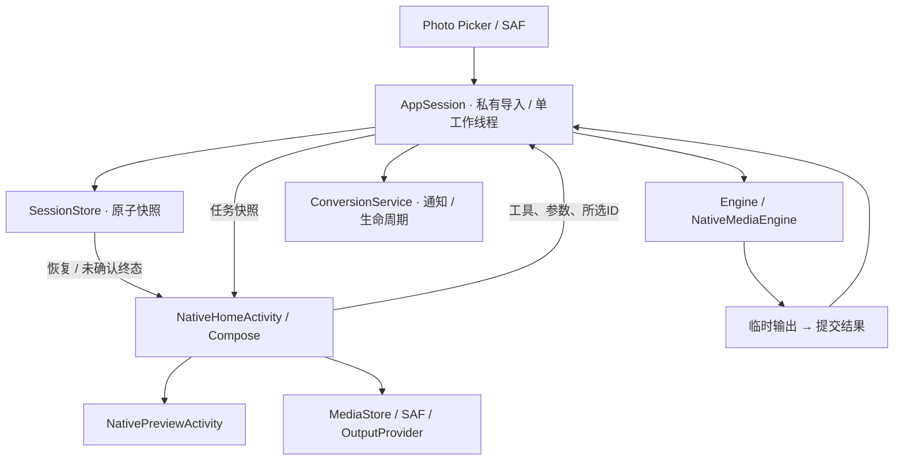

<strong>简体中文</strong> · <a href="ARCHITECTURE.en.md">English</a>

# 技术架构 · 从文件到结果

本文描述1.5.4实际源码：Kotlin/Jetpack Compose + Kyant Backdrop1.0.6 + 原Java会话/转换引擎。历史RN/WebView不参与APK。最低API26，compile/targetSDK36；包名 `cn.qingzhuan.app.preview`。验证事实见[发布记录](RELEASE_1_5_4.md)。

## 主链路

| 层 | 源码与责任 |
| --- | --- |
| 宿主 | `NativeHomeActivity.kt`：选择器、偏好、会话订阅、保存/分享，不实现转换 |
| 首页 | `home/NativeHome.kt`：输入ID、目标、展开格式、共享进度p、交互阶段与球内反馈 |
| 模态 | `GlassSheetHost.kt`、`NativeSheets.kt`：材质、过渡、焦点/Back、列表和参数 |
| 能力 | `HomeModels.kt`、`ToolRouting.java`：整批共同能力、目标过滤，编码器选项来自实际探测 |
| 图像 | `ImageOptionsPanel.kt`、`ImageTransformPolicy.java`、`Engine.java`：高级开关、几何与明确编码质量 |
| 媒体 | `NativeMediaEngine.java`、`MediaOptions.java`、`MotionPhoto.java`、`GifWriter.java` |
| 状态 | `AppSession.java`、`SessionStore.java`、`TaskLedger.java`、`ConversionOutcomes.java` |
| 语言 | `AppText.java`、`TextCatalog.java`、`UiText.kt`、`native-assets/strings_en.json` |
| 预览 | `NativePreviewActivity.kt`、`NativePreviewAssets.kt`、`NativePreviewText.kt` |

## 交互进度与真实任务分开

阶段为EMPTY → READY → CONVERTING → RETURNING → SUCCESS。选择目标后才出现玻璃罩。拖动直接更新p与横向位移，球中心/半径和正文模糊/位移/透明度由p计算；底部提示也由p模糊、上移、消失。提前松手弹回，到有效区域松手才提交真实任务，无障碍动作复用同一入口。弹窗、格式展开、忙碌状态阻止新手势。

球内至少1200ms可见反馈，不代表所有阶段都有实测百分比。未知进度是等待反馈；真实任务成功后才走满、绿勾和原路返回。任务ID、输出和终态来自AppSession，与动画是否播完无关。

## 真实采样与弹性

普通控件只采样背景层；球采样背景加页面内容，球本身在捕获层外。选择器将背景与独立文字层组合，镜片不进入自身采样源，避免反馈回路。当前球沿用1.4的Kyant参数；保留的参考Shader常量不叠加到当前球。

GlassSheetHost与Activity同窗口，直接采样主场景；24dp磨砂/弱折射贯穿把手、标题、正文和底部安全区。没有再次裁切照片，也没有独立不透明弹窗系统栏；内部控件采样面板材质层。退出未结束仍接管Back/遮挡，背景隐藏无障碍且不可键盘聚焦，面板焦点组禁止移出。列表有界，删除确认在列表上方。

卡片保留Pager触摸阈值、点击和分页；即时页位置与弹簧滞后位置共同产生分层扇形反馈。边界弹性只消费未处理的横向增量。单张静止，生命周期停止清理边界动画，减少动效跳过弹性。API33+使用RuntimeShader，旧系统降级；实际触感/帧时间需设备测量。

## 图片输出策略

先按EXIF方向获得可见尺寸，再由纯Java ImageTransformPolicy计算目标。高级关闭时忽略旧edge/quality，保持原尺寸与质量100。预设按方向边界框fit且不放大；自定义锁比例为fit，解锁为精确宽高。仅在目标较小时sample解码，再执行方向矩阵和最终缩放。超过目标像素或实际堆预算明确报错，不静默缩图。

编码传入明确质量：`qualityFor(true)`管理图片，PDF栅格用独立edge/quality。PNG质量不可调；JPEG100仍有损。WebP按系统和质量使用显式无损/有损路径，旧系统保留兼容编码器。处理为8位sRGB位图，不保证EXIF/ICC/HDR往返；原输入不覆盖。

## 语言与内容边界

Android13+用公开LocaleManager应用语言API；首页处理locale/layoutDirection变化以保留remember选择及任务。旧系统用同一偏好。UiLanguageProvider观察配置，通过CompositionLocal供UiText/ui/Glyph使用；原生Toast、通知、诊断标签和媒体控件同样读取AppText。

TextCatalog预编译模式并限制缓存。文件名、文档文字和许可原文走普通Text；动态标签保留捕获文件名，错误原因可有限递归翻译。任务ID和存储的原始错误不变。手机非中文语言默认英文。相册/SAF等系统UI仍由Android提供。

BackgroundStyle保存模式、模糊、修订号、颜色、预设及深浅遮罩。背景导入有界解码后原子替换，失败保留旧图。遮罩与模糊独立，预设PNG由附带原创解析场脚本生成。

## 存储、后台与权限

AppSession保存applicationContext，单工作线程串行执行；Activity和服务各自监听，不互相替换。私有输入为 `filesDir/inputs`、结果为 `filesDir/results`、快照为 `session-v2.json`。提交保存工具/参数/所选ID；过程快照约每2秒持久化，临时输出提交后才成为结果。未确认转换终态独立保留，避免后续保存覆盖。

前台服务只管理通知、取消和有时限唤醒锁，状态仍在AppSession。API35媒体使用mediaProcessing，普通任务dataSync。普通切后台继续；强停/进程死亡不是自动续编码，恢复标记中断，已提交结果保留。

媒体用MediaStore，文档用SAF；保存失败保留源结果并删除当前未完成条目。OutputProvider仅暴露已知结果ID受控URI，预览Activity/服务不导出。无INTERNET或全盘读取权限，私有数据不是云备份。

## 构建与恢复

Compose/宿主在 `android/app/src/main/java`，原Java业务在 `app/src/main/java`；`native-assets`合并资产。JDK17+、Gradle8.13、SDK/Build Tools36，无Node/Expo/NDK。

策略/文案/两个Android28 JVM检查、编译、包身份是不同证据，不证明真机光学、帧率或全部编码保真。旧整套UI回归未在本轮重跑。

各阶段提交Git并持久替换同一源码检查点；ZIP含平面源码、完整Git bundle、RESUME、日志和测试XML。私钥独立保存，不入Git/源码。先读CURRENT_CHECKPOINT和DEVELOPMENT再接续，不能在新检查点成功前删除旧临时副本。
